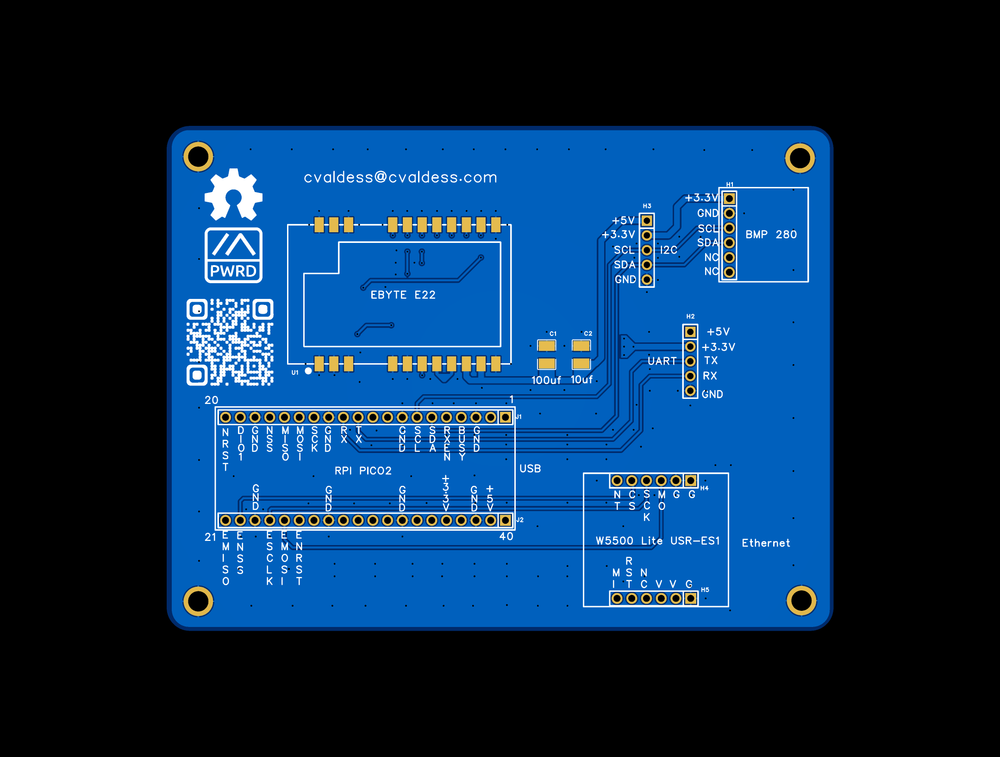
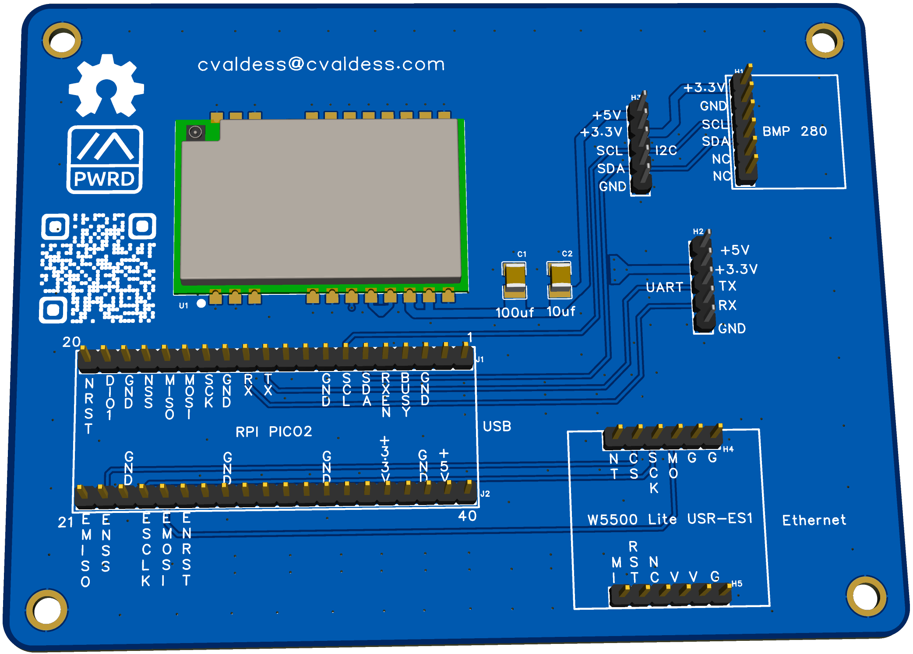
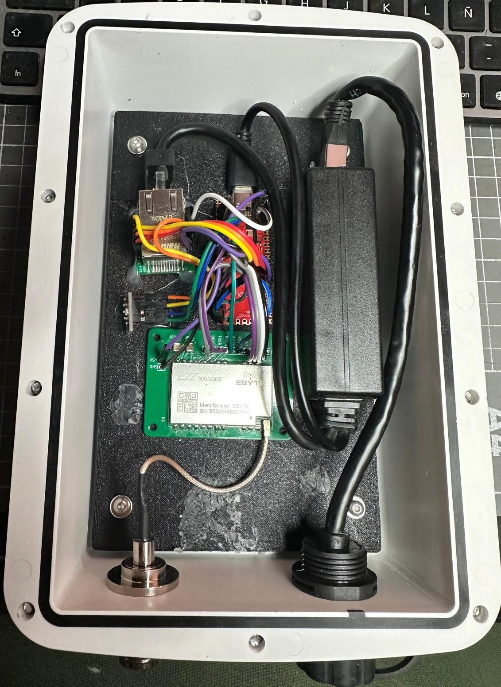
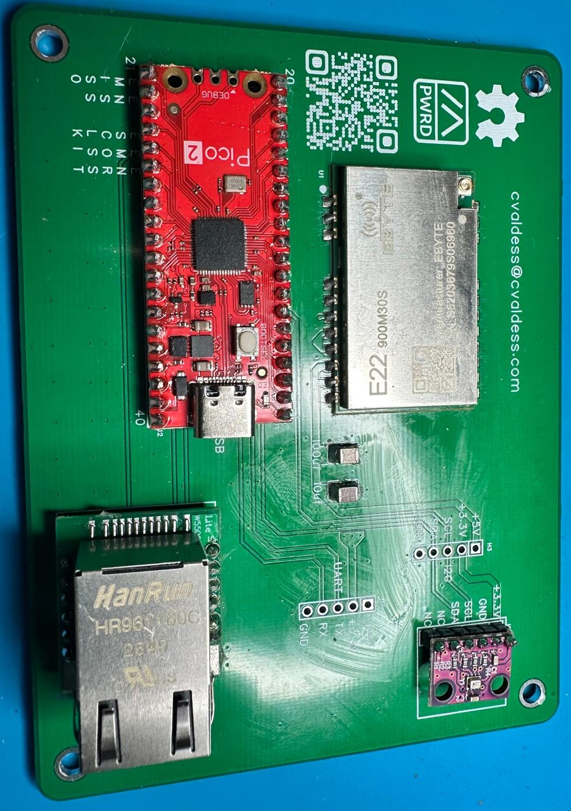
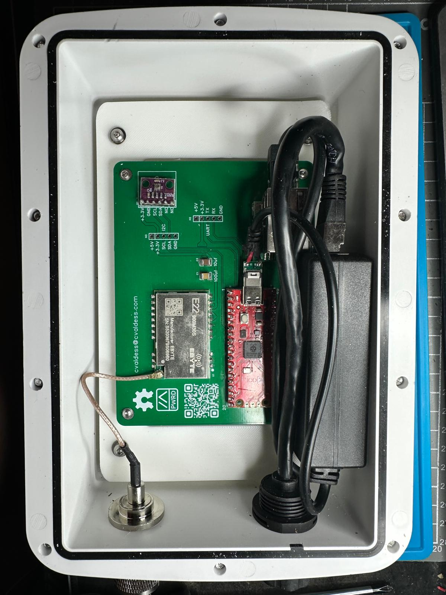

# Pico2_W5500_E22

A custom PCB carrier board that integrates a **Raspberry Pi Pico 2**, **W5500 Ethernet module**, and **Ebyte E22 LoRa module** into a single compact design for Meshtastic applications and Low cost Ethernet MQTT Gateway. 

## Where to buy

Everything needed to build this board yourself is in this repository, under the GPL — including the
[gerber files](Gerber_Pico2_W5500_E22.zip). If you would rather skip the sourcing and the soldering,
assembled units are available:

**[Buy an assembled board →](https://meshtastic.cvaldess.com/nmpoe)** — €49.99, built, flashed and
tested before it ships. Ships from Spain to the EU.

Nothing is held back for the sale: send the gerbers above to any board house and you get the same
board.

> Meshtastic is a trademark of Meshtastic LLC. This board is an independent design, not
> affiliated with or endorsed by Meshtastic LLC.

## License

This project is licensed under the [GNU General Public License v2.0](LICENSE).

## Author

**@cvaldess** — [cvaldess@cvaldess.com](mailto:cvaldess@cvaldess.com) - [meshtastic.cvaldess.com](https://meshtastic.cvaldess.com)

## PCB

[JLCPCB](https://jlcpcb.com/?from=MJCHJNNSFFPCJAEEP)

## Features

- **Raspberry Pi Pico 2** — RP2350-based microcontroller with dual-core Arm Cortex-M33 / RISC-V
- **W5500 Lite (USR-ES1)** — Hardwired TCP/IP Ethernet controller via SPI for reliable wired network connectivity
- **Ebyte E22 (900M30S)** — LoRa transceiver module (900 MHz, 30 dBm) for long-range wireless communication
- **BMP280 sensor header** — Dedicated footprint (H1) for a BMP280 temperature and pressure sensor via I2C
- **I2C expansion header** (H3) — +5V, +3.3V, SCL, SDA, GND for additional I2C peripherals
- **UART expansion header** (H2) — +5V, +3.3V, TX, RX, GND for serial communication
- **Decoupling capacitors** — 100 µF and 10 µF for power supply filtering
- **PoE PD** - Power Supply.

## Board Images

| 3D Render | Prototype | Assembled | Funcional |
|:---------:|:---------:|:---------:|:---------:|
|  |  |  |  |

## Schematic

The full schematic is available as an SVG file:

- [SCH_Schematic-Pico2_W5500_E22.svg](SCH_Schematic-Pico2_W5500_E22.svg)

## Bill of Materials

| Component | Description | Quantity |
|-----------|-------------|:--------:|
| [Raspberry Pi Pico 2](https://s.click.aliexpress.com/e/_c3U7kirP) | RP2350 microcontroller board | 1 |
| [USR-ES1 W5500](https://s.click.aliexpress.com/e/_c4eyUbRF) | SPI Ethernet module | 1 |
| [Ebyte E22-900M30S](https://s.click.aliexpress.com/e/_c3ABeS7X) | SX1262 Wireless Transceiver LoRa Module (30 dBm) | 1 |
| [BMP280 module](https://s.click.aliexpress.com/e/_c3lamruN) | I2C temperature & pressure sensor | 1 |
| [C1 — 100µF](https://s.click.aliexpress.com/e/_c2I8FhOZ) | Ceramic capacitor | 1 |
| [C2 — 10µF](https://s.click.aliexpress.com/e/_c2I8FhOZ) | Ceramic capacitor | 1 |
| [Pin headers](https://s.click.aliexpress.com/e/_c3xaLyyp) | 2.54 mm male/female headers | As needed |
| [PoE to USB-C 802.3af](https://s.click.aliexpress.com/e/_c3vekIoh) | 802.3af PoE to USB-C Power Source | 1 |
| [PoE Injector 802.3af](https://s.click.aliexpress.com/e/_c3LHjvOt) | 802.3af PoE Injector | 1 |
| [N pigtail](https://s.click.aliexpress.com/e/_c3n4Hui9) | N Female to U.FL RG178 | 1 |
| [RJ45 Connector](https://s.click.aliexpress.com/e/_c3GQpW4D) | Waterproof CAT6 RJ45 Panel Connector | 1 |

## Pin Mapping

### W5500 Ethernet (SPI)

| W5500 Pin | Pico 2 Pin |
|-----------|------------|
| MISO      | SPI MISO   |
| MOSI      | SPI MOSI   |
| SCK       | SPI SCK    |
| CS        | SPI CS     |
| RST       | GPIO       |
| INT       | GPIO       |

### Ebyte E22 LoRa (UART + Control)

| E22 Pin | Pico 2 Pin |
|---------|------------|
| TX      | UART RX    |
| RX      | UART TX    |
| M0      | GPIO       |
| M1      | GPIO       |

### BMP280 Sensor (I2C) — H1

| BMP280 Pin | Signal |
|------------|--------|
| VCC        | +3.3V  |
| GND        | GND    |
| SCL        | I2C SCL|
| SDA        | I2C SDA|

### I2C Expansion — H3

| Pin | Signal |
|-----|--------|
| 1   | +5V    |
| 2   | +3.3V  |
| 3   | SCL    |
| 4   | SDA    |
| 5   | GND    |

### UART Expansion — H2

| Pin | Signal |
|-----|--------|
| 1   | +5V    |
| 2   | +3.3V  |
| 3   | TX     |
| 4   | RX     |
| 5   | GND    |

## Manufacturing

Gerber files for PCB fabrication are included:

- [Gerber_Pico2_W5500_E22.zip](Gerber_Pico2_W5500_E22.zip)

These files are ready to be uploaded to any PCB manufacturer (JLCPCB, PCBWay, OSH Park, etc.).
## Firmware

Pre-built Meshtastic firmware for the Pico2 + W5500 + E22 hardware, this version include "Use with client.meshtastic.org" feature, Choose your installation method:

### Method 1: Direct USB flash (UF2)
Hold the BOOTSEL button while connecting the Pico2 via USB, then drag-and-drop the UF2 file onto the RPI-RP2 drive that appears.

- [Download .uf2 file](https://meshfiles.cvaldess.com/firmware-pico2_w5500_e22.uf2)

### Method 2: Ethernet OTA utility
Update an already-deployed node over the network using the [Ethernet OTA utility](https://github.com/meshtastic/firmware/pull/10136). Download the BIN file and upload it through the utility.

- [Download .bin file](https://meshfiles.cvaldess.com/firmware-pico2_w5500_e22.bin)

### Method 3:
In our Client Area you can easy Flah it and Configure, also can protect your image with custom PSK.

 - [Client Area](https://clientarea.cvaldess.com/)

## CA2RXU LoRa APRS iGate/Digipeater firmware

Since November 2026 this board is supported by the official
[CA2RXU LoRa APRS iGate/Digipeater](https://github.com/richonguzman/LoRa_APRS_iGate) firmware (RP2350 + Ethernet port, merged in
[richonguzman/LoRa_APRS_iGate#438](https://github.com/richonguzman/LoRa_APRS_iGate/pull/438)), env `pico2_w5500_e22`.
Fit a 433 MHz E22 / E22P module: LoRa APRS runs on 433.775 MHz.

The images below are built from the official repository (`main` at `a9cf1a1`, 17 Nov 2026).
From the next iGate release on, the same board also comes as a zip in its [Releases](https://github.com/richonguzman/LoRa_APRS_iGate/releases).

### Method 1: Direct USB flash (UF2)
Hold the BOOTSEL button while connecting the board via USB, then drag-and-drop the UF2 file onto the RP2350 drive that appears.

 - [Download .uf2 file](https://meshfiles.cvaldess.com/igate-pico2_w5500_e22-1117.uf2)

### Method 2: Ethernet OTA
Update an already-deployed iGate over the network from its web page.

 - [Download .bin file](https://meshfiles.cvaldess.com/igate-pico2_w5500_e22-1117.bin)

### First boot
The board gets its address by DHCP. Open `http://<board-ip>/` (look the address up in your router)
to set the callsign, the APRS-IS passcode and the rest of the configuration.

### What it does on this board
- Receive-only iGate (RF to APRS-IS, `qAO`), position beacon over RF and APRS-IS, T# telemetry.
- Digipeater (WIDEn-N) and backup digipeater while APRS-IS is down; channel check (CAD) before every transmission.
- The same web page as the ESP32 boards, with the live stations map and network OTA; KISS TNC server
  (TCP 8001), MQTT, remote syslog, SNTP, DHCP or static IP.
- Not available: gating APRS-IS messages and objects back to RF, and the CrossFreq digipeater.

The firmware expects the E22's TXEN driven by DIO2 (the default). With TXEN wired to GP6 instead,
build it yourself from the iGate repository with `-D RADIO_TXEN=6` added to the env's `build_flags`
(`pio run -e pico2_w5500_e22`).

## Use Cases

- Meshtastic mesh network
- Low cost MQTT Gateway
- APRS iGate/Digipeater
- Remote environmental monitoring (temperature, pressure)
- LoRa-based sensor networks with Ethernet gateway
- Industrial IoT data collection nodes
- Weather station with wired and wireless connectivity
